# 像素办公室 · dsh-pixel-office

> 把 DeepSeek Harness 里的 AI 会话，变成一间看得见的像素办公室——16 只宝可梦分部门坐班，谁在忙、谁在摸鱼，一眼看到。
>
> **仓库地址**：<https://github.com/zhxu8977/dsh-pixel-office>

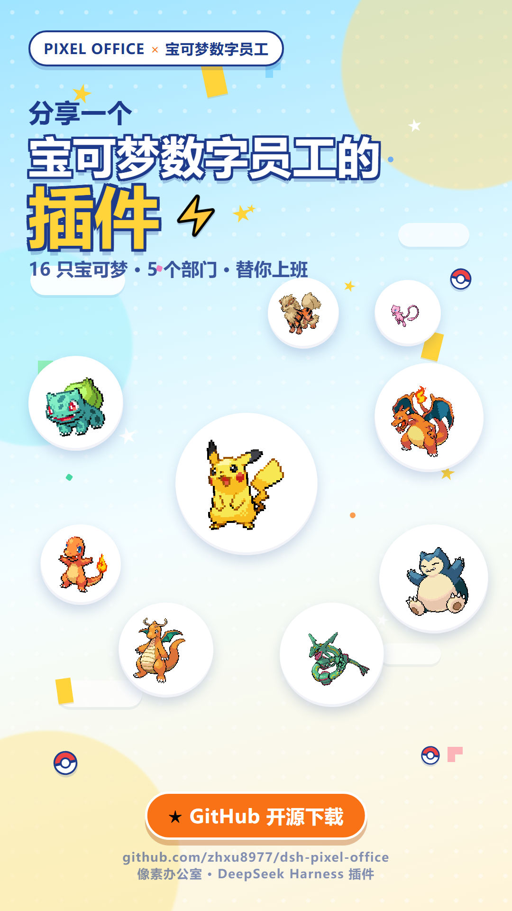

---

## 这是什么

**dsh-pixel-office** 是 DeepSeek Harness（DSH）的本地插件（Web 客户端 + Node 宿主双半侧）。

它为你的每一次 AI 对话生成一位「宝可梦员工」：员工坐在像素办公室的工位上，头顶有名牌和状态条；不同工作区的对话会自动分配到对应的办公室；所有对话状态、交接和消息都以像素动画呈现。

插件不改变你的工作流——你照常聊天，办公室自己在动。

---

## 功能特性

| 能力 | 说明 |
|---|---|
| 🏢 多办公室 | 科研、公众号、视频、个人事务、老婆任务……办公室可新建 / 改名 / 删除 |
| 🐾 宝可梦员工 | 每个员工是一只宝可梦，带角色名、模型、工位名牌与状态条 |
| 🔄 自动同步 | 每 5 秒扫描本机 DSH 会话，按「工作区 → 办公室」规则自动分配、自动判定忙碌 / 空闲 |
| 🔴 六种状态 | 忙碌 / 思考中 / 等待 / 空闲 / 出错 / 离线；空闲时工位条轮播「摸鱼中 / 喝咖啡 / 随时待命 / 发呆中」 |
| ✉️ 消息传递 | 老板可给所有人 / 某个办公室 / 某只精灵发消息，地图上信封飞向收件人 |
| 📋 会议室 · 早会 | 各办公室负责人围坐汇报昨天 / 今天；跨办公室只共享任务标题 |
| 🎬 三种视图 | 动画（地图）/ 文字（列表）/ 分栏，一键切换，支持全屏 |
| 🖥️ 多种摆法 | 侧栏挂件 / 独立窗口 / 打开窗口 / 分栏 |
| 🧠 一人多岗 | 一个精灵最多同时负责 3 个对话；全忙时按属性自动招新人 |
| 🧩 模型自由 | 每只精灵单独选择模型（Claude / GLM / DeepSeek / Codex 混搭），选中立即生效 |
| 📚 876 种宝可梦 | 内置图鉴，中英文可搜；输入英文名自动下载素材、自动改名 |
| 💾 本地优先 | 全部数据在本机 `~/.dsh/pixel-office/`，不上传、不联网（除下载精灵素材） |

---

## 截图

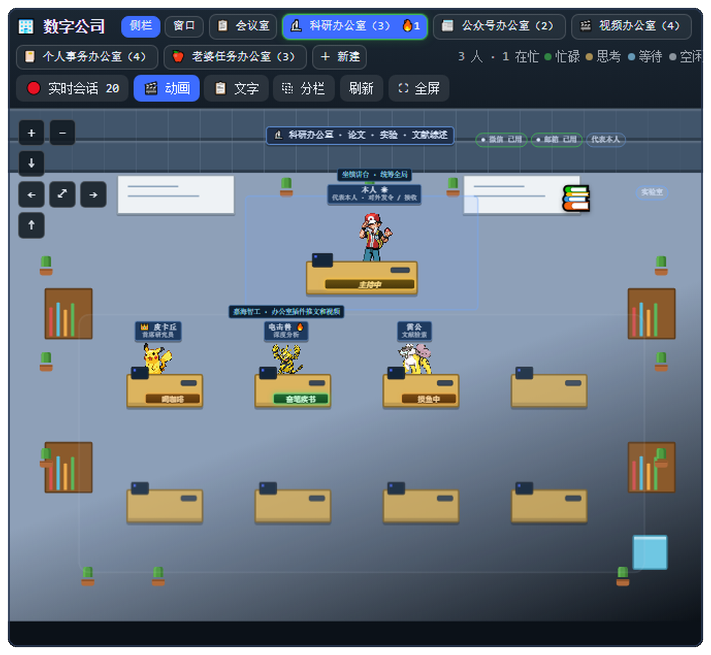

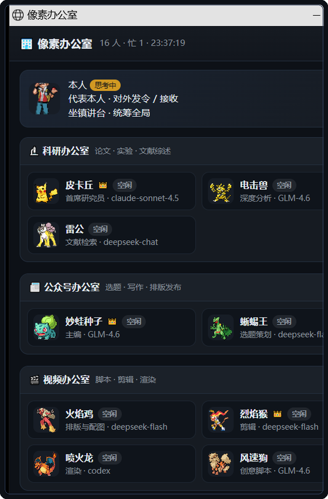

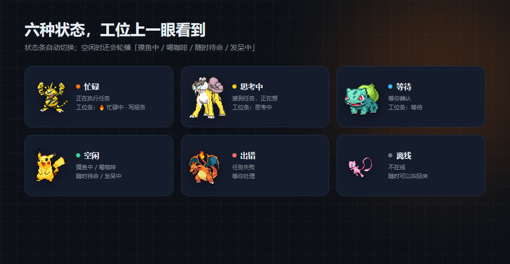

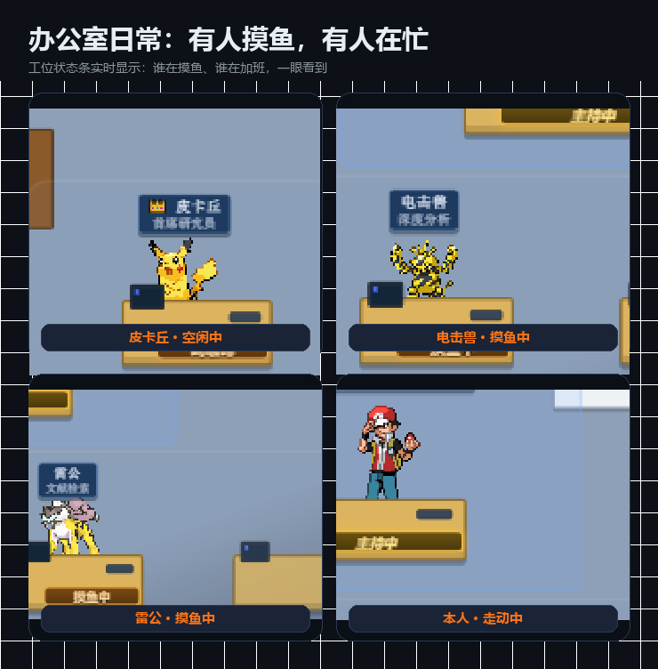

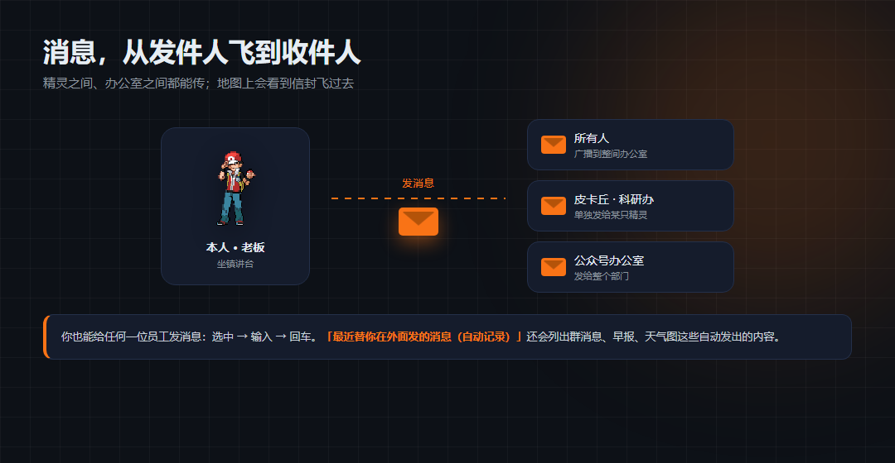

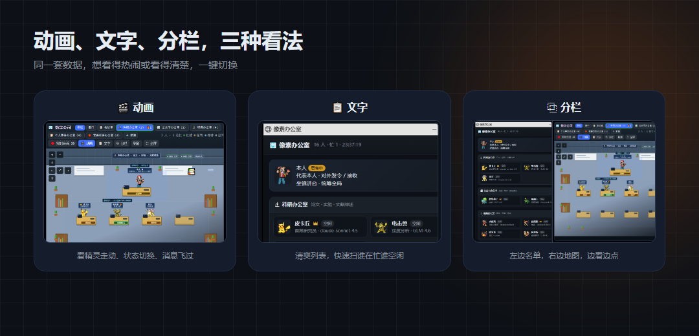

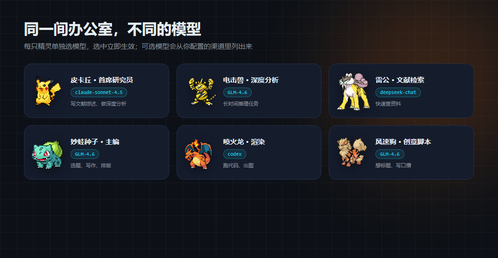

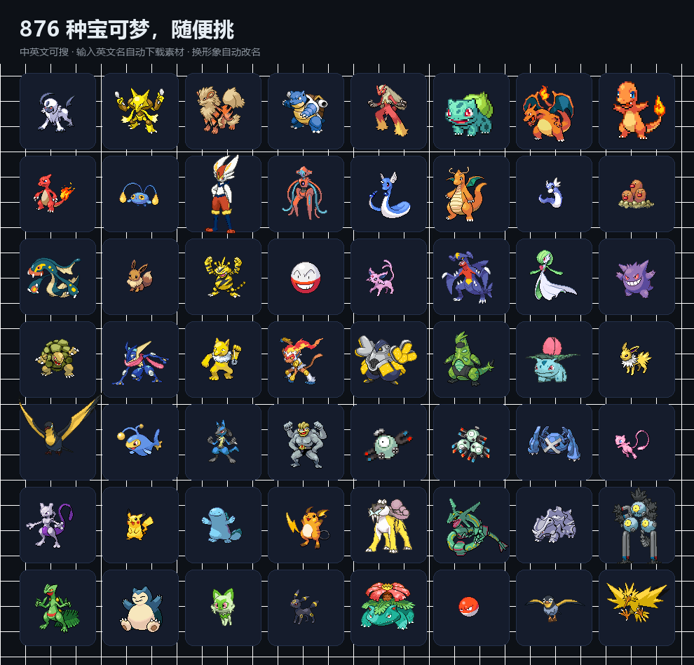

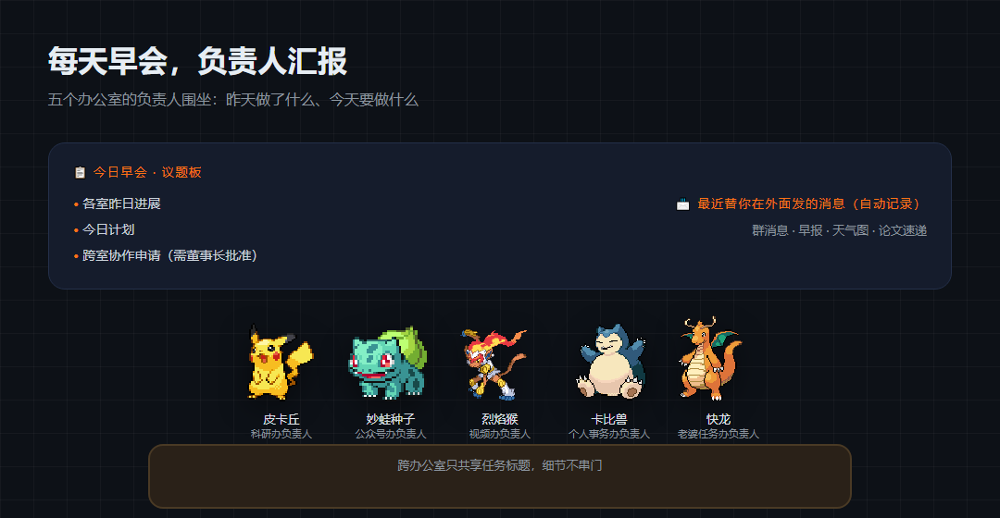

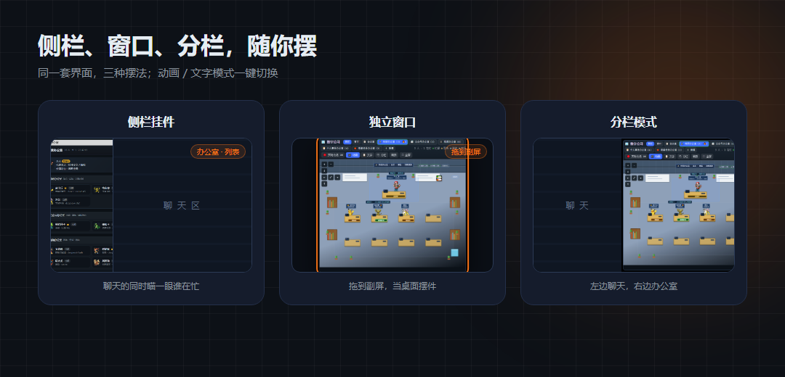

---

## 快速开始

### 环境要求

- DeepSeek Harness 桌面版 / Web 版（0.1.x）
- Windows（自动同步进程依赖本机会话缓存路径；其他平台可自行改路径）
- Node.js 22+（DSH 自带）

### 安装

1. 下载本仓库（GitHub 页面 **Code → Download ZIP**，或 `git clone`），解压到本地插件目录：

```
~/.dsh/local-plugins/dsh-pixel-office/
├─ package.json
├─ cordis.patch.yml
└─ lib/
```

2. 在 DSH profile 的 `cordis.patch.yml`（如 `~/.dsh/profiles/desktop/cordis.patch.yml`）里挂载：

```yaml
- insert:
    - id: pixel-office6
      name: file:///C:/Users/<你的用户名>/.dsh/local-plugins/dsh-pixel-office/lib/index.js
```

3. 重启 DSH（桌面版重启应用；Web 版重启 `dsh web`）。

4. 侧边栏底部出现「办公室」入口，点开即可使用。

> 本插件**没有 npm 依赖**（React 运行时已内置在 `lib/vendor/`），无需 `npm install`。

### 首次使用

1. 打开面板，老板（本人）默认坐在讲台。
2. 打开「自动同步」进程（见下），或手动登记状态。
3. 随便开一个对话，看宝可梦自己报到。

---

## 自动同步（可选，但强烈推荐）

自动同步常驻进程 `live-sync.cjs` 会：

- 每 **5 秒**扫描 `~/.dsh/storages/session_projcache/sessions` 下的会话缓存；
- 按 **路由规则** 把会话分配到对应办公室；
- 按会话缓存 **最近 90 秒**的修改时间判定忙碌 / 空闲；
- 一个精灵同时负责多个对话（最多 3 个），全忙时按「同属性、不重名、形象存在」规则自动招新人；
- 可选的**模型自动切换**（down-only：只降级不升级）。

路由规则写在 `~/.dsh/pixel-office/routing.json`：

```json
{
  "version": 1,
  "autoSync": {
    "enabled": false,
    "intervalMs": 5000,
    "busyWindowMs": 180000,
    "maxSessions": 20,
    "manualStaleMs": 180000,
    "modelSwitch": { "enabled": true, "mode": "downgrade-only" }
  },
  "rules": [
    { "workspace": "project_001", "match": "prefix", "office": "research" },
    { "workspace": "公众号", "match": "contains", "office": "media", "name": "小助手" }
  ],
  "fallbackOffice": "research",
  "filters": {
    "skipTitles": ["(未命名)", "新会话", "New thread"],
    "skipTitlePrefixes": ["Side: "]
  }
}
```

字段说明：

| 字段 | 说明 |
|---|---|
| `rules[].workspace` | 工作区名（DSH 会话所属工作区的名称/路径前缀） |
| `rules[].match` | `exact`（默认）/ `prefix` / `contains` |
| `rules[].office` | 目标办公室 id |
| `rules[].name` | 可选，固定该工作区员工的名字 |
| `fallbackOffice` | 未命中规则时的默认办公室；`null` = 不接管 |
| `autoSync.enabled` | `false` 时由常驻进程 `live-sync.cjs` 负责同步（推荐） |
| `autoSync.busyWindowMs` | 会话缓存多少毫秒内有写入算「在忙」 |
| `autoSync.modelSwitch` | 模型自动切换（`downgrade-only`：只降级不升级） |

> `routing.json` 是**本机数据文件**，不会提交到仓库；仓库里的 `README` 只给示例。

启动自动同步（Windows）：

```bat
wscript "C:\Users\<你>\.dsh\pixel-office\live-sync.vbs"
```

停止：任务管理器结束对应 node 进程，或使用 `sync.cmd` 提供的开关。

---

## 手动登记状态

自动同步关闭时，可以用命令行工具手动改状态：

```bat
:: 列出全部员工
node office.mjs list

:: 改单个员工
node office.mjs set --member pikachu --status busy --task "在写文献综述"
node office.mjs set --member pikachu --status idle

:: 所有人回到空闲
node office.mjs all-idle

:: 重置为默认编制
node office.mjs seed
```

状态可选：`idle | busy | thinking | waiting | error | offline`。

也可以走 HTTP（面板同款接口）：

```bat
:: 读取状态
curl http://127.0.0.1:<DSH端口>/dsh-pixel-office/state

:: 给员工发消息
curl -X POST http://127.0.0.1:<DSH端口>/dsh-pixel-office/message ^
  -H "content-type: application/json" ^
  -d "{\"from\":\"boss\",\"to\":\"pikachu\",\"text\":\"来活了\"}"
```

> DSH 每次重启端口会变，可在 DSH 设置或启动日志里查。

---

## 面板操作

| 操作 | 说明 |
|---|---|
| 顶部标签 | 侧栏 / 窗口 / 打开窗口 / 会议室 / 各办公室 / ＋新建 |
| 办公室标签 | 点击切换；数字为该室人数；👑 为负责人 |
| 动画 / 文字 / 分栏 | 三种视图切换 |
| 实时会话 | 查看当前接入的 DSH 会话 |
| 点击精灵 | 查看详情：模型、状态、任务、最近消息；可改模型 |
| 会议室 | 早会汇报：各室昨天 / 今天进展与跨室协作申请 |
| 全屏 | 面板全屏（适合副屏当摆件） |

---

## 数据与目录

全部数据在 `~/.dsh/pixel-office/`：

```
pixel-office/
├─ state.json        # 老板 / 办公室 / 员工 / 消息
├─ routing.json      # 工作区 → 办公室路由 + 自动同步开关
├─ history.json      # 早会快照（每 15 分钟一次）
├─ catalog.json      # 876 种宝可梦图鉴
├─ names-zh.json     # 中文名映射
├─ sprites/          # 精灵素材（GIF / PNG，下载后缓存）
└─ live-sync.cjs     # 自动同步常驻进程
```

> 注意：`state.json` 是本机数据，**不要提交到仓库**（已在 `.gitignore` 中排除）。

---

## 技术架构

### 宿主半侧（`lib/index.js`）

注册 HTTP 接口：

| 方法 | 路径 | 用途 |
|---|---|---|
| GET | `/dsh-pixel-office/state` | 老板 / 办公室 / 员工 / 消息 |
| GET | `/dsh-pixel-office/sessions` | 当前 DSH 会话列表 |
| GET | `/dsh-pixel-office/sprites` | 精灵素材列表 |
| GET | `/dsh-pixel-office/catalog` | 宝可梦图鉴 |
| GET | `/dsh-pixel-office/standup` | 早会汇报 |
| GET | `/dsh-pixel-office/panel` | 独立窗口页面 |
| POST | `/dsh-pixel-office/set` | 改员工 / 老板属性 |
| POST | `/dsh-pixel-office/office` | 新建 / 改名 / 删除办公室 |
| POST | `/dsh-pixel-office/message` | 发消息 |
| POST | `/dsh-pixel-office/messages/clear` | 清空消息 |
| POST | `/dsh-pixel-office/fetch-sprite` | 下载精灵素材 |

### 客户端半侧（`lib/client.js`）

- 通过 `window.__ModuleLoader__.load` 注册
- 注入 `@deepseek-ai/dsh-client-ui-layout` / `ui-sidebar` / `locale`
- 渲染侧边栏入口、地图、列表、分栏、会议室、消息
- 独立窗口复用同一套 React 组件（`lib/panel.html`）

### 自动同步（`live-sync.cjs`）

- 每 5 秒轮询会话缓存目录
- 差分检测「任务交接」与「消息」并触发飞行动画
- 只降级不升级的模型切换（可关）

---

## 常见问题

**Q：面板打不开 / 地图空白？**
A：确认插件已挂载到当前 profile，重启 DSH；检查 `/dsh-pixel-office/state` 是否可访问。

**Q：自动同步没反应？**
A：确认 `live-sync.vbs` 已运行；检查 `routing.json` 的工作区路径是否匹配；看 `live-sync.log`。

**Q：端口是多少？**
A：DSH 每次重启端口会变，以启动日志 / GUI 地址为准；也可在插件路由前缀下探测。

**Q：能换宝可梦吗？**
A：可以。面板里打开图鉴，输入英文名（如 `snorlax`），自动下载素材并改名。

**Q：会联网吗？**
A：只有下载精灵素材时会访问素材源，其余全部本地。

---

## 许可

- 代码：MIT License（见 [LICENSE](LICENSE)）
- 宝可梦角色、名称、形象版权归 **任天堂 / Game Freak / The Pokémon Company** 所有；本仓库使用的像素素材仅用于个人学习与自用展示，请勿商用。
- 本插件为社区项目，与 DeepSeek、任天堂均无关联。

---

## 致谢

- DeepSeek Harness 插件体系
- 宝可梦像素素材（社区图鉴）
- 所有在办公室里上班的宝可梦